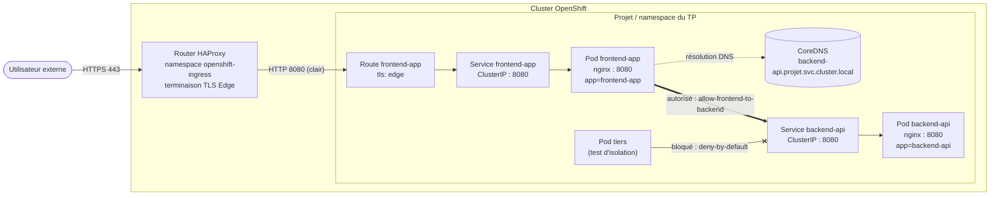

# OpenShift Network Lab

Travaux pratiques Red Hat Academy (cursus DO180 / DO280) : déploiement de deux micro-services sur OpenShift, résolution DNS interne, route TLS de type Edge, isolation réseau Zero Trust avec les NetworkPolicies et diagnostic d'une erreur 503.

Auteur : Amenallah Aouadi, ISI Kef (Network and Systems Engineering).

## Sommaire

1. [Architecture](#architecture)
2. [Structure du dépôt](#structure-du-dépôt)
3. [Prérequis](#prérequis)
4. [Démarrage rapide](#démarrage-rapide)
5. [Détail des composants](#détail-des-composants)
6. [Matrice des flux réseau](#matrice-des-flux-réseau)
7. [Tests et validation](#tests-et-validation)
8. [Dépannage 503](#dépannage-503)
9. [Captures d'écran](#captures-d%C3%A9cran)
10. [Limites connues](#limites-connues)

## Architecture



### Principe

| Couche | Rôle |
|---|---|
| Route (Edge) | Expose le frontend en HTTPS. Le routeur HAProxy chiffre côté client puis relaie en HTTP clair vers le pod. |
| Service (ClusterIP) | Adresse virtuelle stable et nom DNS interne. Le sélecteur de labels alimente les Endpoints. |
| Deployment / Pod | Conteneur nginx écoutant sur 8080 (image `quay.io/redhattraining/hello-world-nginx`). |
| NetworkPolicy | Passage du modèle allow-all à un modèle Zero Trust : tout est refusé, puis seuls les flux légitimes sont ouverts. |

## Structure du dépôt

```
openshift-network-lab/
├── README.md
├── LICENSE
├── .gitignore
├── .github/
│   └── workflows/
│       └── lint.yml                    # yamllint + shellcheck
├── manifests/
│   ├── 01-apps/
│   │   ├── backend-api.yaml            # Deployment + Service
│   │   └── frontend-app.yaml           # Deployment + Service
│   ├── 02-routes/
│   │   └── frontend-app-edge.yaml      # Route TLS Edge
│   └── 03-networkpolicies/
│       ├── 01-deny-by-default.yaml
│       ├── 02-allow-frontend-to-backend.yaml
│       └── 03-allow-from-openshift-ingress.yaml   # optionnel
├── scripts/
│   ├── deploy.sh                       # déploiement complet
│   ├── test-dns.sh                     # Partie 1
│   ├── test-networkpolicy.sh           # Partie 3
│   ├── troubleshoot-503.sh             # Partie 4
│   └── cleanup.sh
└── docs/
    ├── Compte_rendu_OpenShift.docx
    └── screenshots/                    # captures numérotées 01 à 19
```

## Prérequis

- Un projet OpenShift (par exemple `tp-reseau-<votre-nom>`) et le client `oc` connecté au cluster.
- Droits de création de Deployments, Services, Routes et NetworkPolicies dans le projet.

## Démarrage rapide

```bash
git clone https://github.com/<votre-compte>/openshift-network-lab.git
cd openshift-network-lab

oc new-project tp-reseau-<votre-nom>
./scripts/deploy.sh

./scripts/test-dns.sh
./scripts/test-networkpolicy.sh
```

Nettoyage : `./scripts/cleanup.sh`

Équivalent en ligne de commande impérative (comme dans l'énoncé) :

```bash
oc new-app --name=backend-api  --image=quay.io/redhattraining/hello-world-nginx:latest
oc expose service backend-api  --port=8080
oc new-app --name=frontend-app --image=quay.io/redhattraining/hello-world-nginx:latest
oc expose service frontend-app --port=8080

oc delete route frontend-app
oc create route edge frontend-app --service=frontend-app --port=8080

oc apply -f manifests/03-networkpolicies/01-deny-by-default.yaml
oc apply -f manifests/03-networkpolicies/02-allow-frontend-to-backend.yaml
```

## Détail des composants

### Partie 1 : Services et DNS interne

`oc new-app` crée un ImageStream, un Deployment et un Service. CoreDNS résout le nom court `backend-api` vers le ClusterIP du service, au format `backend-api.<projet>.svc.cluster.local`.

### Partie 2 : Route TLS Edge

Terminaison TLS au niveau du routeur HAProxy. Le certificat par défaut du cluster de laboratoire est auto-signé, d'où l'option `-k` de curl.

```bash
oc get route frontend-app
curl -k https://<host-de-la-route>
```

### Partie 3 : NetworkPolicies

| Fichier | Effet |
|---|---|
| `01-deny-by-default.yaml` | `podSelector: {}` sélectionne tous les pods, `ingress: []` n'autorise aucune source : tout trafic entrant est refusé. |
| `02-allow-frontend-to-backend.yaml` | Autorise les pods `app=frontend-app` à joindre les pods `app=backend-api`. |
| `03-allow-from-openshift-ingress.yaml` | Optionnel : autorise le routeur à joindre le frontend (voir limites). |

## Matrice des flux réseau

| Source | Destination | Port | Avant deny-all | Après les 2 policies du TP |
|---|---|---|---|---|
| Utilisateur | Route frontend-app | 443 | autorisé | autorisé côté routeur |
| Routeur HAProxy | Pod frontend-app | 8080 | autorisé | bloqué sans la règle optionnelle 03 |
| Pod frontend-app | Service backend-api | 8080 | autorisé | autorisé |
| Pod tiers | Service backend-api | 8080 | autorisé | bloqué |
| Pod tiers | Pod frontend-app | 8080 | autorisé | bloqué |

## Tests et validation

| Test | Commande | Résultat attendu |
|---|---|---|
| DNS interne | `./scripts/test-dns.sh` | Page nginx « Hello, world from nginx! » |
| Route Edge | `curl -k https://<host>` | HTTP 200 |
| Frontend vers backend | `./scripts/test-networkpolicy.sh` (test 1) | HTTP 200 |
| Pod tiers vers backend | `./scripts/test-networkpolicy.sh` (test 2) | Timeout, « Bloqué (OK) » |

Livrables du TP :

```bash
oc get networkpolicies
oc describe route frontend-app
```

## Dépannage 503

Méthode du dehors vers le dedans : `./scripts/troubleshoot-503.sh [app]`

| Étape | Commande | Critère |
|---|---|---|
| 1. Endpoints | `oc get endpoints frontend-app` | `<none>` : le sélecteur du Service ne correspond à aucun pod |
| 2. Ports | `oc get svc frontend-app -o yaml` et `oc get deploy frontend-app -o yaml \| grep -i port` | `targetPort` identique au `containerPort` |
| 3. Pods | `oc get pods -l deployment=frontend-app` | `Running 1/1`, pas de `CrashLoopBackOff` |
| 4. Événements | `oc get events --sort-by=.lastTimestamp` | Erreurs de pull, de probes, de scheduling |
| 5. NetworkPolicies | `oc get networkpolicies` | Le routeur doit pouvoir joindre le pod |

## Captures d'écran

Les captures numérotées sont dans [`docs/screenshots/`](docs/screenshots/) et le compte rendu complet dans [`docs/Compte_rendu_OpenShift.docx`](docs/Compte_rendu_OpenShift.docx).

## Limites connues

- Avec `deny-by-default`, le routeur OpenShift n'est plus autorisé à joindre le frontend. Dans l'énoncé du TP ce cas n'est pas traité : si la route renvoie un 503 après l'application des policies, appliquer `03-allow-from-openshift-ingress.yaml`.
- Les manifests déclaratifs fournissent les labels `app` et `deployment` comme le fait `oc new-app`. Les noms de pods, hosts de route et IP varient selon le cluster.
- Ce dépôt est un support pédagogique et ne vise pas la production : pas de `NetworkPolicy` egress, pas de certificat personnalisé, un seul réplica.

## Licence

MIT
